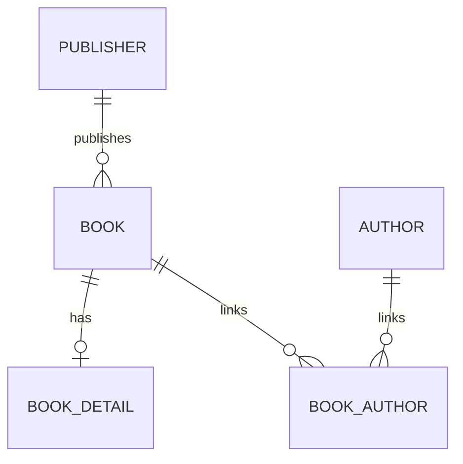

# 图书系统示例说明

本项目使用图书域演示 MyBatis / MyBatis-Plus。`BookXmlDemo` 展示基础 SQL 与 XML 操作，`LibraryDemo` 是关联查询和 MyBatis-Plus 功能的交互式入口。

## 数据模型

| 表 | 作用与关键列 |
| --- | --- |
| `publisher` | 出版社，主键 `publisher_id` |
| `book` | 书籍，主键 `book_id`，`publisher_id` 外键；还含价格、折扣、审计时间、删除标记和版本号 |
| `book_detail` | 书籍详情，`book_id` 同时是主键和外键，因此每本书最多一条详情 |
| `author` | 作者，主键 `author_id` |
| `book_author` | 作者书籍关联表，`(book_id, author_id)` 联合主键，可让两边各关联多条记录 |

样例数据提供五家出版社、八本书、七条详情、三位作者和八条作者书籍关联。出版社 40、50 没有书籍；书籍 8 没有详情和作者，可用于观察 `LEFT JOIN` 的空关联。一本书只能属于一家出版社，而一家出版社可以出版多本书。

## 关系查询入口

| 关系 | Java 方法 | MyBatis 映射 |
| --- | --- | --- |
| 出版社 → 多本书 | `PublisherMapper.selectWithBooks(id)` | `<collection property="books">` |
| 书籍 → 详情 | `BookMapper.selectWithDetail(id)` | `<association property="detail">` |
| 书籍 → 出版社 | `BookMapper.selectWithPublisher(id)` | `<association property="publisher">` |
| 书籍 → 多位作者 | `BookMapper.selectWithAuthors(id)` | `<collection property="authors">`，经 `book_author` |
| 作者 → 多本书 | `AuthorMapper.selectWithBooks(id)` | `<collection property="books">`，经 `book_author` |

实现位置为 `src/main/resources/mapper/{Publisher,Book,Author}Mapper.xml`。每个子集合都有 `<id>`，MyBatis 会在 JOIN 返回多行时合并同一对象。自定义关联 SQL 显式过滤 `book.deleted = 0`；MyBatis-Plus 为 `BaseMapper<Book>` 生成的查询则使用 `@TableLogic` 自动添加过滤。

## 运行

1. 确认 Java 11+ 与 Maven 可用，在本地准备 MySQL 8，并设置 `src/main/resources/db.properties`（或使用 `LAB_DB_DRIVER`、`LAB_DB_URL`、`LAB_DB_USER`、`LAB_DB_PASSWORD`）。可提交的 `db-defaults.properties` 只含占位配置。
2. 执行 `src/main/resources/sql/reload_library.sql`。脚本会删除并重建上述五张图书表，同时清理旧实验表；运行前先检查需要保留的数据。
3. 在 IDEA 运行 `com.demo2.util.BookXmlDemo.main`，顺序观看基础 SQL、动态 SQL、CRUD 和批量操作；运行 `com.demo2.util.LibraryDemo.main`，菜单 1–5 对应五种关联方向，菜单 6 为条件查询，7 为聚合查询，8 为分页查询。菜单 6–8 只运行代码中预设的只读示例，不接收自定义条件；菜单 9–12 依次演示自动填充、字段策略、逻辑删除和乐观锁。每项写入演示结束即回滚。

只需验证映射时，不必启动 MySQL。运行 `mvn "-Dtest=LibraryMapperTest" test`，测试使用内存 H2，自动建表并加载同样的样例数据。IDEA 的 Maven 参数填写 `-Dtest=LibraryMapperTest test`，不要加单引号。

## MyBatis-Plus 要点

`BookMapper extends BaseMapper<Book>` 提供普通 CRUD、`selectCount`、`selectOne`、`selectMaps`、`selectByMap` 和 `selectPage`。`Wrappers.lambdaQuery()` 用方法引用选择字段，字段改名时编译器能帮助发现错误；`and(q -> q...or()...)` 表示带括号的复合条件。聚合示例使用 `QueryWrapper` 写 `COUNT(*)` 并按 `category` 分组。`MyBatisUtil` 的 `MybatisPlusInterceptor` 注册了分页与乐观锁插件。

`AuditMetaObjectHandler` 自动填充 `createTime` 和 `updateTime`。`createTime` 使用 `updateStrategy = NEVER`，避免更新时误改创建时间；`discount` 使用 `updateStrategy = NOT_NULL`，实体更新中 `null` 表示保留旧折扣。需要将折扣真正设为 SQL `NULL` 时，应显式使用更新包装器的 `set(Book::getDiscount, null)`。`@TableLogic` 将 `deleteById` 改写为更新 `deleted = 1`，而生成的普通查询忽略已删除行。`@Version` 让 `updateById` 检查旧版本并递增版本号；若影响行数为 0，应重新读取，再根据业务决定重试或提示冲突。关联 XML 的删除过滤由 SQL 本身负责。

控制台查询不存在的编号会提示相应的表与主键列。SQL 调试输出默认关闭，需要观察实际 SQL 时可将 `log4j.properties` 里的 `log4j.logger.com.demo2.mapper` 改成 `DEBUG`。

详细课程讲义见 [条件构造器与高级查询](08-02-query-wrapper.md) 和 [分页、自动填充、逻辑删除与乐观锁](08-03-pagination-lifecycle.md)。
